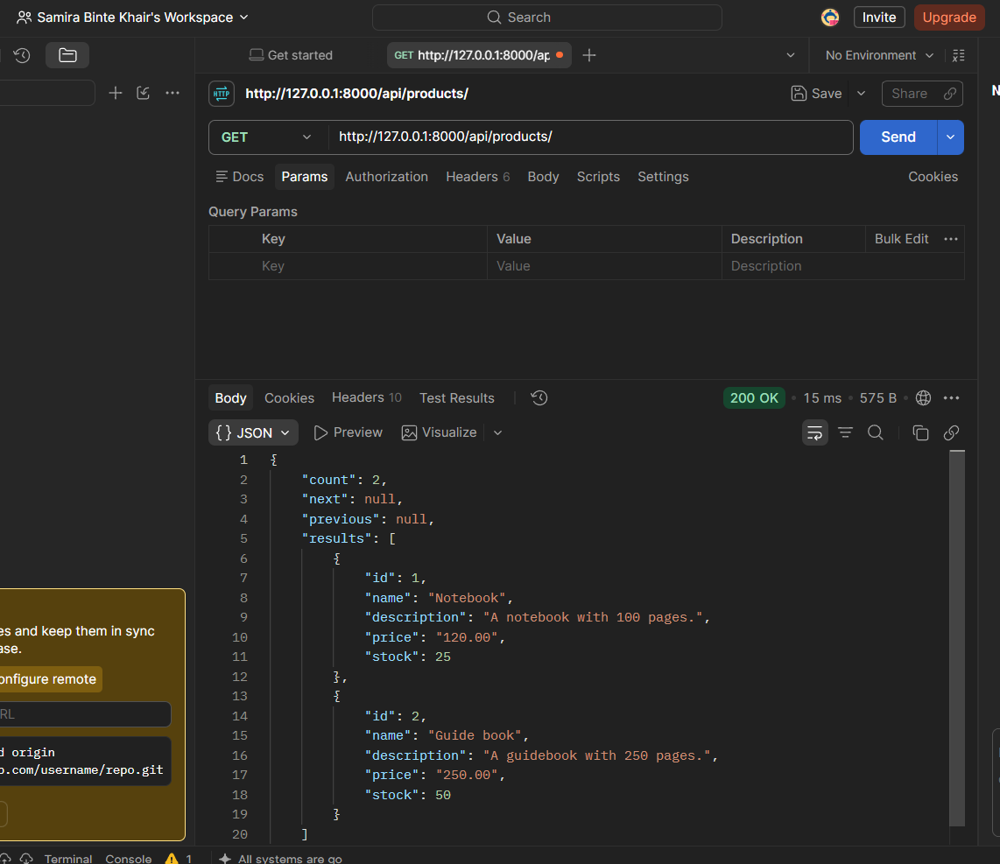
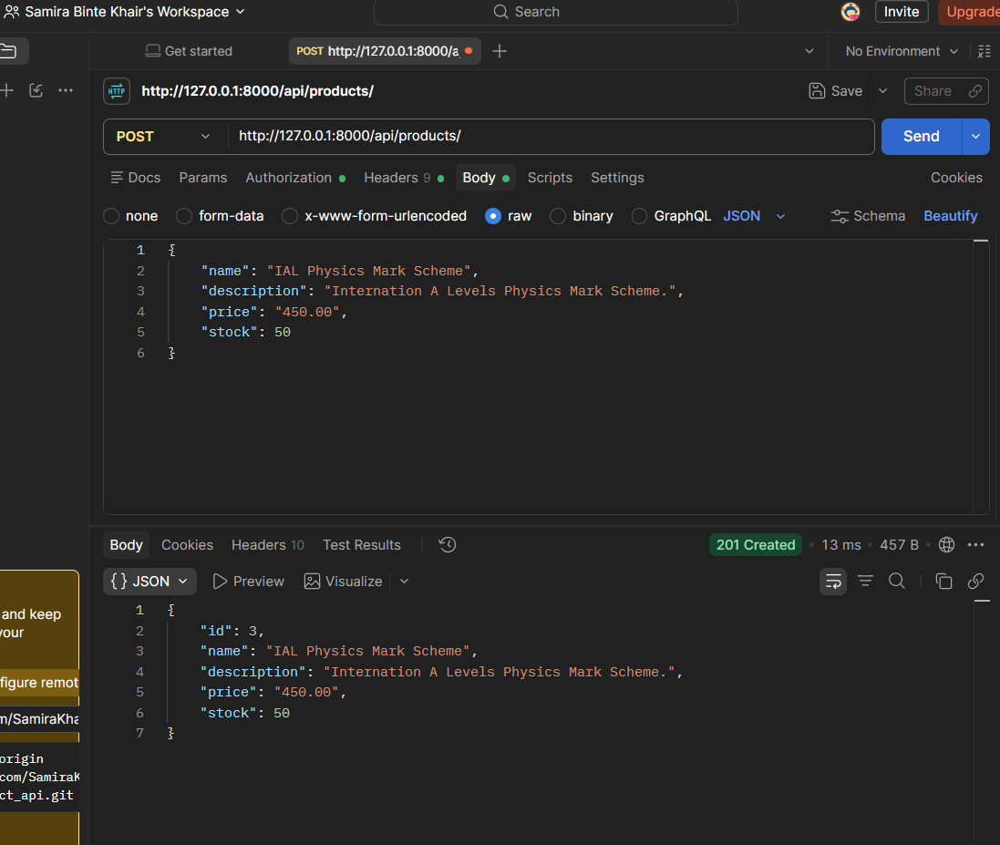
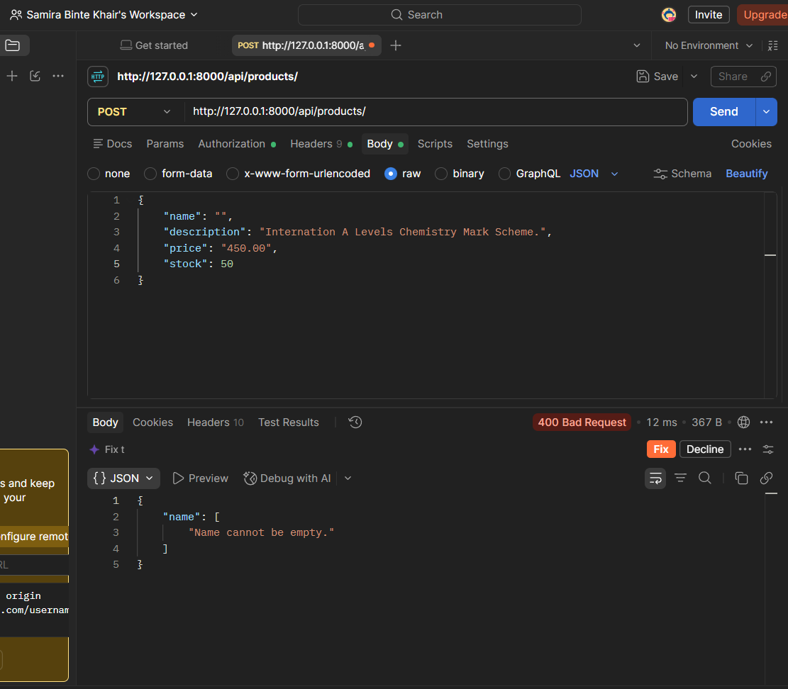
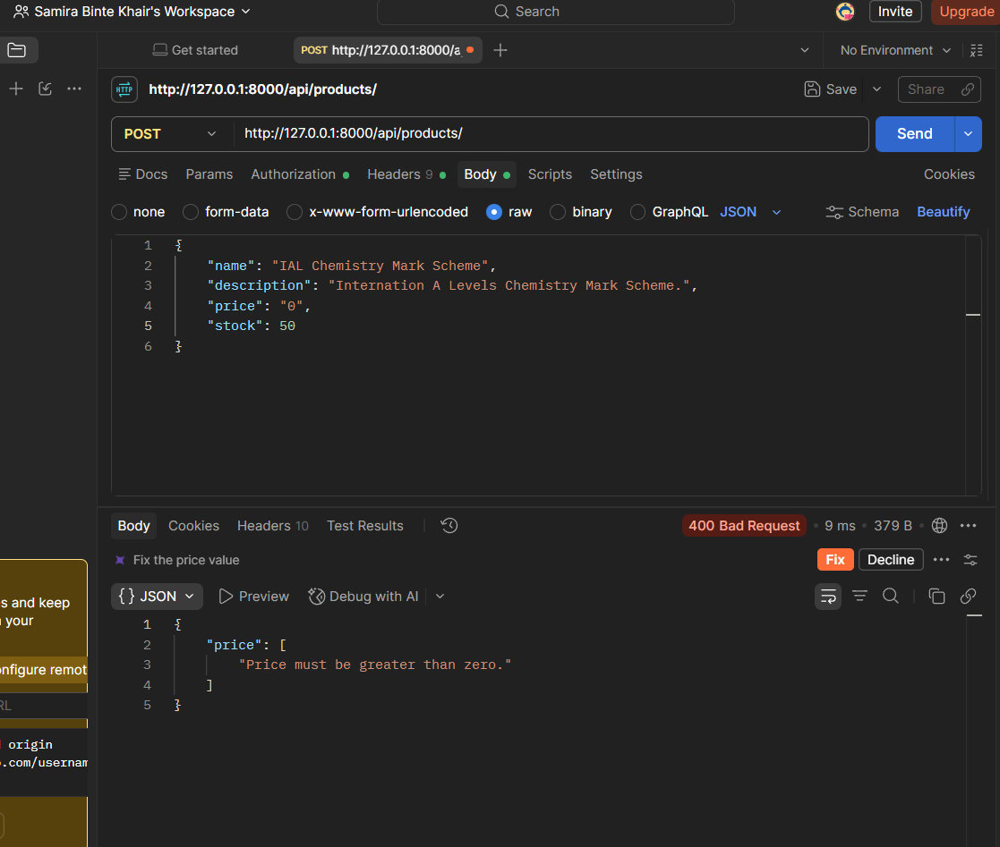
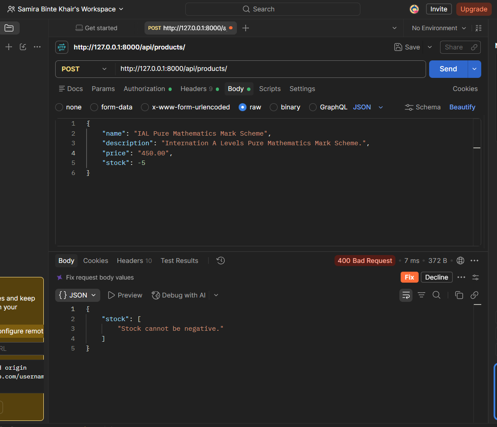
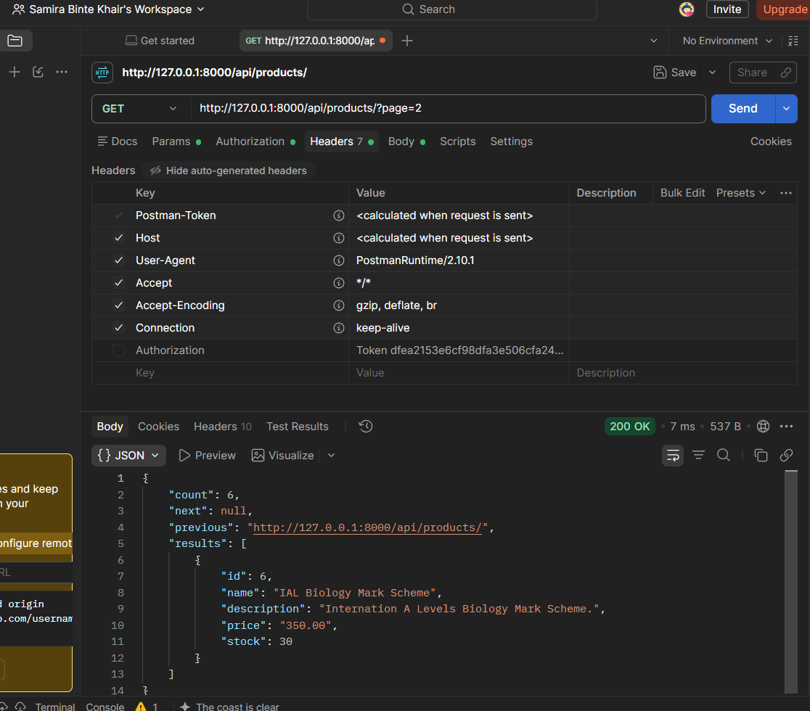

# Simple Product API

A small online shop API built with Python, Django, and Django REST Framework. Anyone can view products; only authenticated users (token authentication) can add new products.

## Endpoints

| Method | URL | Access |
|--------|-----|--------|
| GET | `/api/products/` | Public (paginated, 5 per page, ordered by id) |
| POST | `/api/products/` | Requires `Authorization: Token YOUR_TOKEN` |

## Setup

Run these from the project root (the folder containing `shop_project/`).

**1. Create and activate a virtual environment**

```bash
python -m venv venv
venv\Scripts\activate          # Windows
source venv/bin/activate       # Mac/Linux
```

**2. Install dependencies**

```bash
pip install -r requirements.txt
```

**3. Run migrations**

```bash
cd shop_project
python manage.py migrate
```

**4. Start the server**

```bash
python manage.py runserver
```

The API is now available at `http://127.0.0.1:8000/api/products/`.

## Create a test user and token

```bash
python manage.py shell
```

```python
from django.contrib.auth.models import User
User.objects.create_user(username='testuser', password='testpass123')
exit()
```

```bash
python manage.py drf_create_token testuser
```

Copy the printed token and send it with POST requests as a header:

```
Authorization: Token YOUR_TOKEN
```

Example POST body:

```json
{
  "name": "Notebook",
  "description": "A notebook with 100 pages.",
  "price": "120.00",
  "stock": 25
}
```

## Validation rules

- `name` cannot be empty
- `price` must be greater than zero
- `stock` must be a whole number and cannot be negative

## Screenshots

### Viewing products (no token)


### Creating a product (valid token)


### Authentication error (no token)


### Validation error/ Add product with an empty name


### Validation error/ Add a product with a price of zero or less


### Validation error/ Add a product with negative stock


### Page two of products

